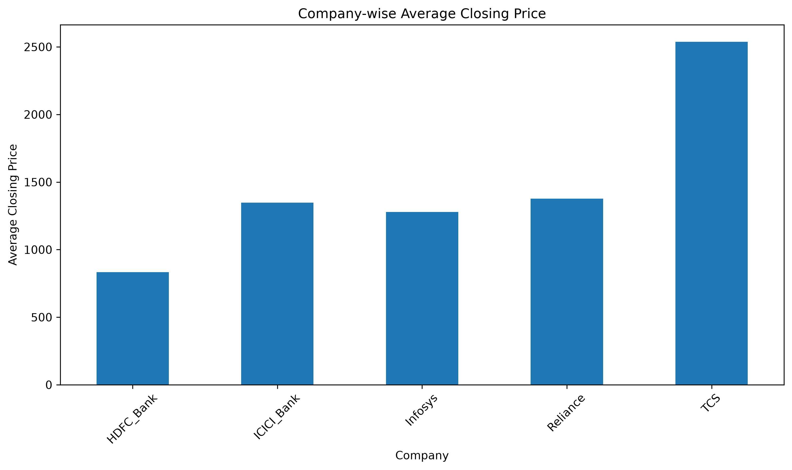
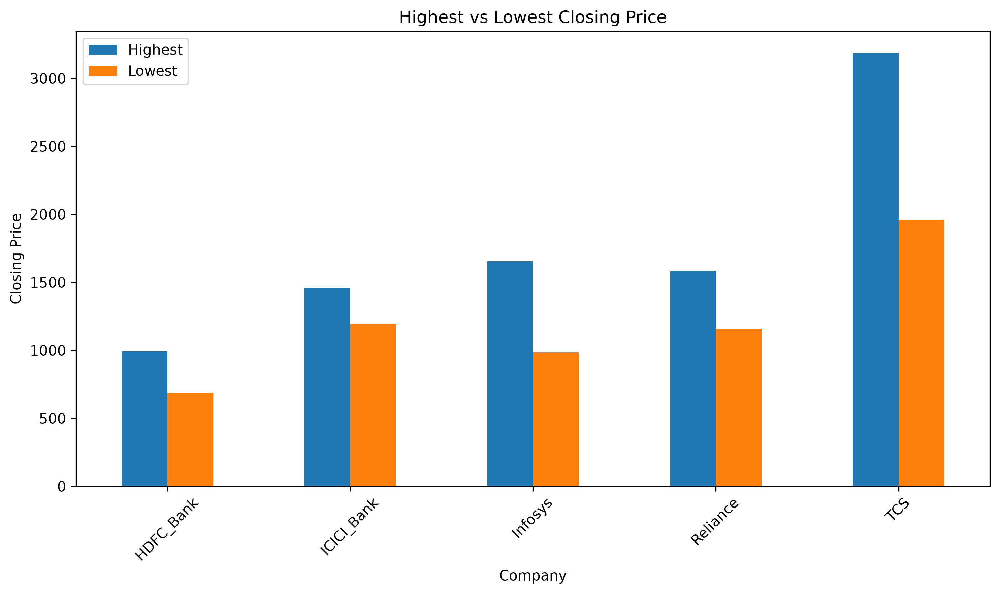
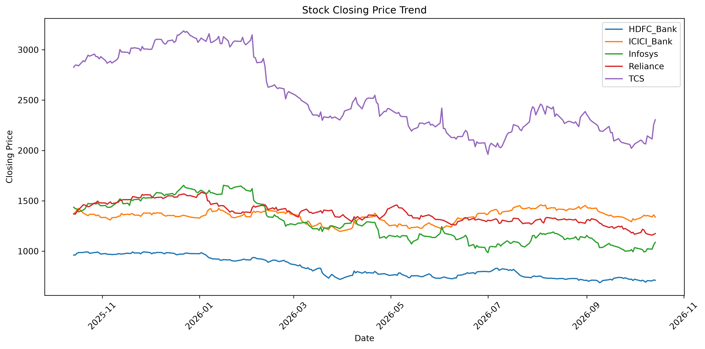
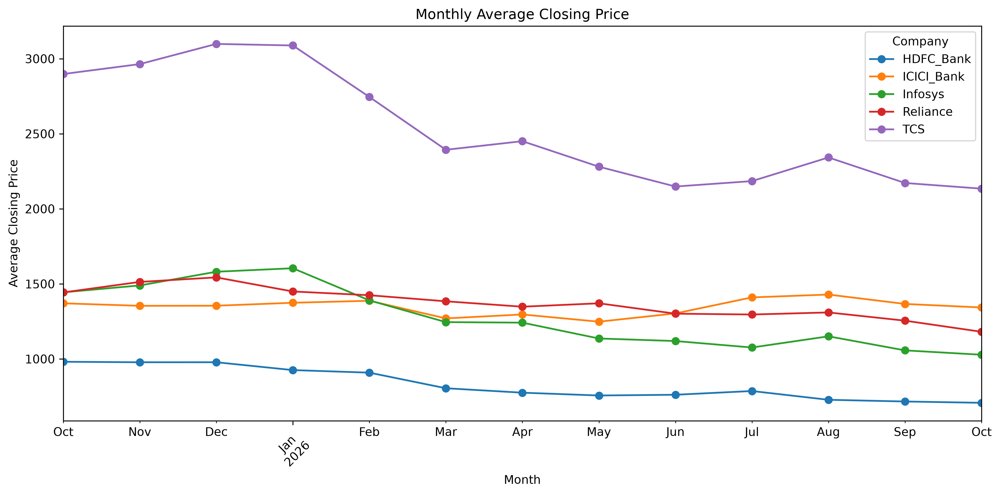
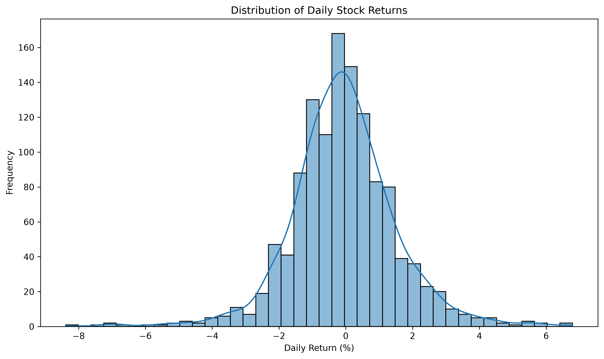
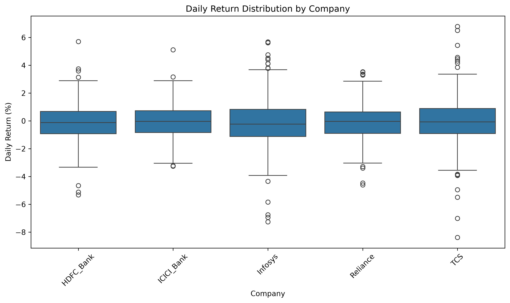
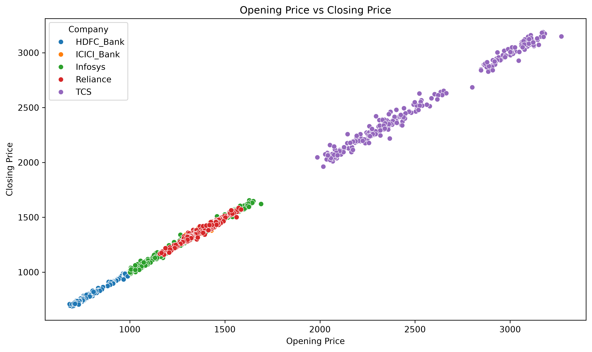
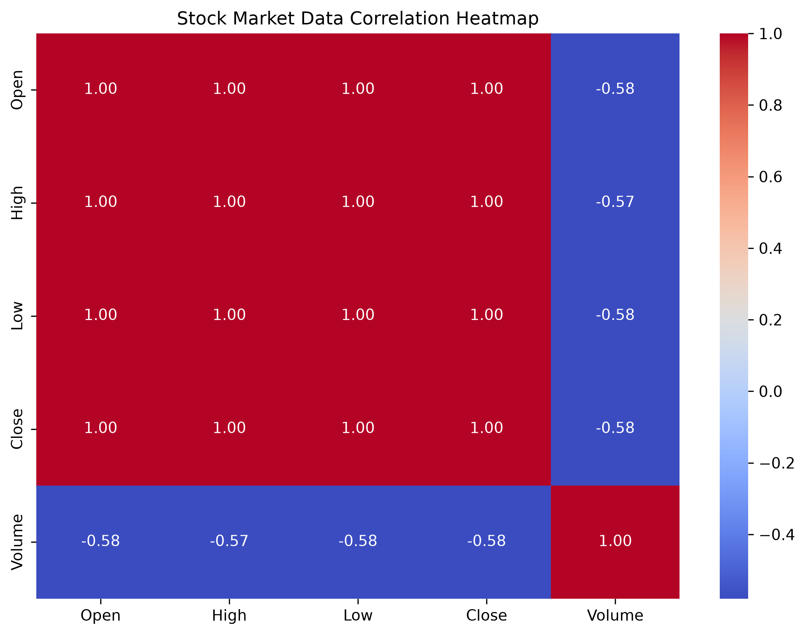

# Stock Market Analysis Using Python and SQL

# About This Project

I built this project to practice data analysis using historical stock market data from Reliance, TCS, Infosys, HDFC Bank, and ICICI Bank.

I used Python, Pandas, SQL, and MySQL to explore stock prices, analyze trading volume, calculate daily percentage returns, and examine monthly price trends. I also created visualizations using Matplotlib and Seaborn to better understand patterns in the data.

# What I Worked On

- Loaded and checked stock market data.
- Compared average, highest, and lowest closing prices.
- Analyzed trading volume across companies.
- Calculated daily percentage returns using Python and SQL.
- Explored monthly average closing prices.
- Used SQL queries with GROUP BY, aggregate functions, LAG(), and CTEs.
- Created visualizations using Matplotlib and Seaborn.
- Saved analysis results and visualization data to CSV files.

# Tools Used

- Python
- Pandas
- MySQL
- SQL
- Matplotlib
- Seaborn

# Project Structure

01_DATA — Python scripts for loading, checking, analyzing, and visualizing data.
02_SQL — SQL queries used for stock market analysis.
03_CHARTS — Generated chart images.
 CSV files — Stock market data and analysis outputs.

# Visualizations

# 1. Average Closing Price

# 2. Highest vs Lowest Closing Price

# 3. Stock Closing Price Trend

# 4. Monthly Average Closing Price

# 5. Average Trading Volume

# 6. Daily Return Distribution

# 7. Daily Return Comparison by Company

# 8. Opening Price vs Closing Price

# 9. Stock Market Correlation Heatmap

#  What I Learned

- Loading and checking tabular data using Pandas.
- Comparing stock prices and trading volumes across companies.
- Calculating and analyzing daily returns.
- Using SQL queries to summarize and analyze data.
- Creating charts to explore stock market trends.
- Organizing a data analysis project into separate folders and scripts.

#  Project Note

This project is for educational purposes and focuses on historical stock market data analysis. The findings do not predict future prices or guarantee returns and should not be considered financial or investment advice. Future improvements may include machine learning and predictive analysis.
